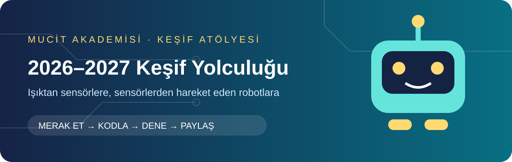

[🏠 Kitabın girişi](../../README.md) · [🚀 Dönem haritası](../README.md)

# 📚 Mucit Akademisi — Öğrenci Ders Notları

Merhaba Mucit! 👋 Burada robotunun nasıl çalıştığını öğrenebilir, unuttuğun konuları tekrar edebilir ve küçük deneylerle kendini geliştirebilirsin.

> [!TIP]
> 🧠 Önce oku → sonucu tahmin et → kendin dene → gözlemle → nedenini açıkla.

## 🗺️ Nereden başlamalıyım?

| Sıra | Ders | Öğreneceğin konu |
|---|---|---|
| 1 | [🤖 RoboMer kartını tanıyalım](01_RoboMer_Kart_Tanitimi.md) | Pin, giriş, çıkış ve kart bağlantıları |
| 2 | [🧠 Algoritmik düşünme](02_Algoritmik_Dusunme.md) | İşlem sırası, koşul ve tekrar |
| 3 | [💻 Satır kodlamaya başlangıç](03_Satir_Kodlamaya_Baslangic.md) | Arduino kodunun yapısı ve temel komutlar |
| 4 | [💡 LED uygulamaları](04_LED_Uygulamalari.md) | Yakma, söndürme, bekleme ve sıralama |
| 5 | [🔘 Buton ve anahtar](05_Buton_ve_Anahtar.md) | Giriş okuma, karar verme ve öncelik |

## 🎯 Bu notları nasıl kullanabilirim?

1. Konuyu oku ve önemli komutları kendi cümlelerinle açıkla.
2. Örnek kodu yüklemeden önce ne yapacağını tahmin et.
3. Kodu çalıştır ve tahminini kontrol et.
4. Bir değişiklik yap. Sonucun neden değiştiğini düşün.
5. “Sen dene” görevlerini kendi kodunla tamamla.

🛠️ Kodum çalışmıyor! Nereden başlayayım?

- **Derlenmiyor:** İlk hata mesajını oku. Noktalı virgül, parantez ve yazım hatalarını kontrol et.
- **Yüklenmiyor:** USB kablosu, kart ve port seçimini kontrol et. Portu kullanan başka uygulamaları kapat.
- **Yükleniyor ama beklediğim gibi çalışmıyor:** Pin numaralarını, giriş değerlerini ve koşulları kontrol et.
- Her seferinde bir değişiklik yap ve yeniden dene.

> [!IMPORTANT]
> Ödevlerini kendin yaz. Yapay zekâya ödev kodunu hazırlatma. Öğretmenin kodundaki komutları ve çalışma mantığını açıklamanı isteyebilir.

🔗 [Arduino uygulama kodları](../Arduino_Kodlari/) · [Dönem ana sayfası](../README.md)

📖 İçerikler RoboMer ders kitabındaki temel konular ve sınıfımızdaki kart bağlantıları esas alınarak hazırlanmıştır. Komut açıklamalarında [Arduino dil başvurusu](https://docs.arduino.cc/language-reference/) kullanılmıştır.

## 🌟 Bugünkü keşif kartım

- [ ] Konuyu kendi cümlelerimle anlattım.
- [ ] Kodun sonucunu önceden tahmin ettim.
- [ ] Bir şeyi değiştirip sonucu gözlemledim.
- [ ] Defterime “Bugün öğrendiğim…” ve “Hâlâ merak ettiğim…” cümlelerini yazdım.

**💬 Arkadaşına meydan oku:** Çözümü söylemeden bir ipucu ver. İkiniz de nedenini açıklayabiliyorsanız görevi tamamladınız!
