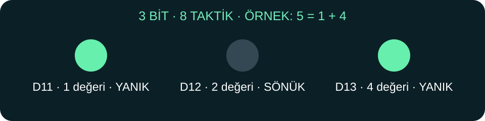

# 💡 1. Durak — Üç LED ile sekiz taktik

**Emre Demiröz · Mucit Akademisi**

Bir bit bir lambaya benzer: **0 = sönük**, **1 = yanık**. Üç lambayla 2 × 2 × 2 = **8 farklı durum** yapabiliriz. Burada 8 bit değil, **3 bit** kullanıyoruz; 8 bit olsaydı 256 farklı değer olurdu.



| D7 basış sayısı (açılıştan) | Sayı | D11 · 1 | D12 · 2 | D13 · 4 |
|---|---|---|---|---|
| 0 | 0 | ⚫ 0 | ⚫ 0 | ⚫ 0 |
| 1 | 1 | 🟢 1 | ⚫ 0 | ⚫ 0 |
| 2 | 2 | ⚫ 0 | 🟢 1 | ⚫ 0 |
| 3 | 3 | 🟢 1 | 🟢 1 | ⚫ 0 |
| 4 | 4 | ⚫ 0 | ⚫ 0 | 🟢 1 |
| 5 | 5 | 🟢 1 | ⚫ 0 | 🟢 1 |
| 6 | 6 | ⚫ 0 | 🟢 1 | 🟢 1 |
| 7 | 7 | 🟢 1 | 🟢 1 | 🟢 1 |
| 8 | 0 | ⚫ 0 | ⚫ 0 | ⚫ 0 |

**Dikkat:** Bu tabloda fiziksel pin sırası D11 → D12 → D13. Bu yüzden 1 sayısı **1 0 0** görünür. Kitaplardaki ikilik yazım büyük bitten başlar: aynı sayı **001** yazılır. İkisi çelişmez; okuma yönü farklıdır.

🧮 **Bulmaca:** D11 ve D13 yanıyor: 1 + 4 = **5**. Peki yalnız D12 yanarsa?

## 🧩 Kod nasıl düşünüyor?

```cpp
tactic = (tactic + 1) % 8; // 0,1,2,3,4,5,6,7, tekrar 0
digitalWrite(11, (tactic & 1) != 0); // 1 değerli bit
digitalWrite(12, (tactic & 2) != 0); // 2 değerli bit
digitalWrite(13, (tactic & 4) != 0); // 4 değerli bit
```

`&` burada belirli bir bitin açık olup olmadığını kontrol eder. D7 basışı 30 ms süzülür; basılı tutmak sayacı sürekli artırmaz. D2 taktik yönüdür: **0 sol, 1 sağ**; sayıyı değiştirmez. Bu bağımsız derste motorlar daima kapalıdır.

[▶ Kodu aç](00_Binary_Taktik.ino) · [🏠 Atölye](../README.md)
