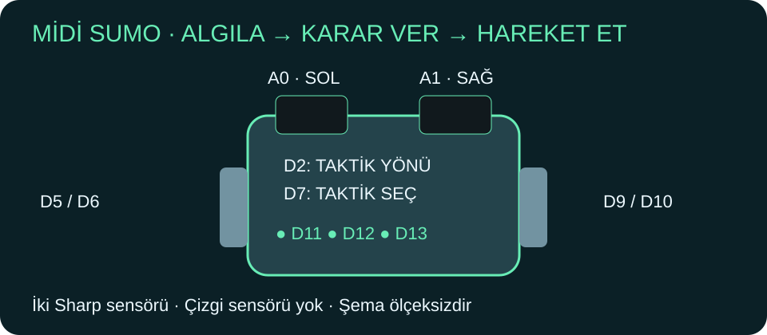
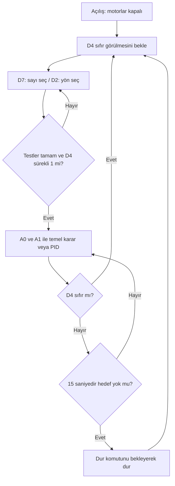
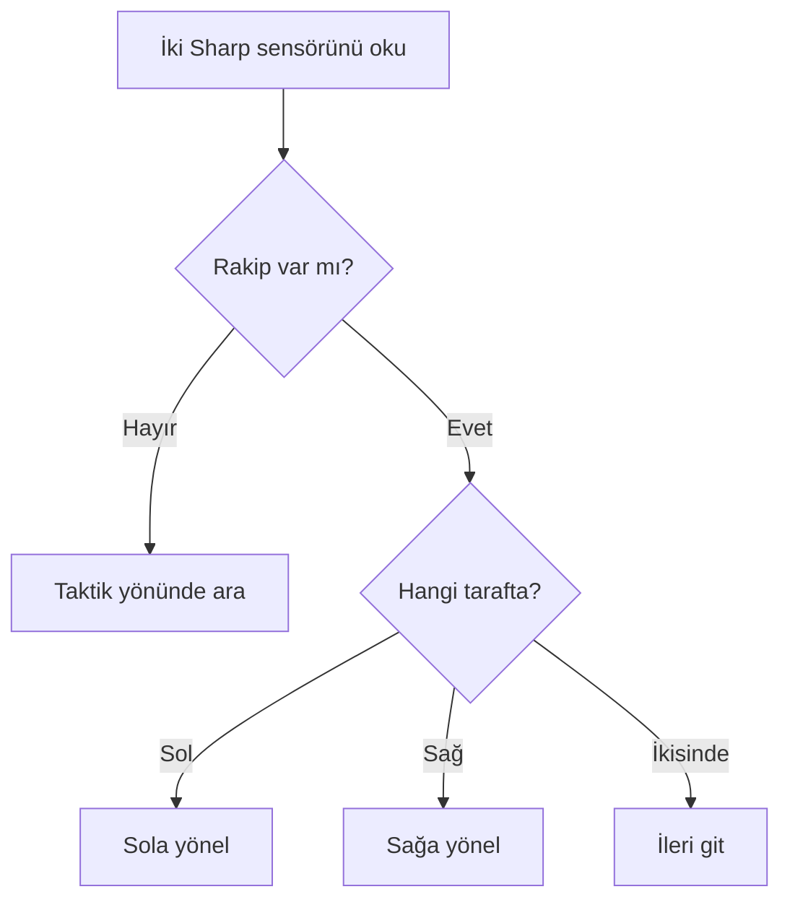

# 🤖 Midi Sumo · Algoritma Atölyesi

**Emre Demiröz · Mucit Akademisi**



> 🧭 Bu sayfadaki sumo **Midi Sumo** içindir: yalnızca iki Sharp GP2Y0A21YK0F (2Y0A21) sensörü vardır. Mini Sumo'nun farklı sensörleri bu koda dahil değildir. Çizgi robotu ise en alttaki ayrı derstir.

| Sıra | Ders | Görev |
|---|---|---|
| 1 💡 | [Binary ve taktik seçimi](00_Binary_Taktik/README.md) | D7 ile 0–7 seç, D11–D13 ile göster. |
| 2 🔎 | [Sharp kalibrasyonu](01_Sharp_Kalibrasyon/01_Sharp_Kalibrasyon.ino) | Motorlar kapalı, A0/A1 ölçümlerini karşılaştır. |
| 3 📡 | [Kumanda / D4 testi](01B_IR_Test/README.md) | Motorlar kapalıyken git/dur sinyalini doğrula. |
| 4 🧱 | [Duvarda dur](02_Duvarda_Dur/02_Duvarda_Dur.ino) | Engel görünce dur, üç LED ve bir saniye buzzer. |
| 5 🏁 | [Temel Midi Sumo](03_Sumo_Temel/03_Sumo_Temel.ino) | Gör → karar ver → hareket et. |
| 6 🎯 | [Midi Sumo PID](04_Mini_Midi_Sumo_PID/04_Mini_Midi_Sumo_PID.ino) | Dönüşü kademeli ayarla. Klasör adı eski bağlantıları korumak için tutuldu. |
| Ayrı ders 🛣️ | [Çizgi deneyleri](05_Cizgi_Deneyleri/05_Cizgi_Deneyleri.ino) | Yalnız çizgi sensör dizisi olan diğer robot içindir. |

## 📖 Kodları nasıl okuyacağız?

Bu dosyalar Arduino IDE'de açılan `.ino` dersleridir. Arduino C++ kullanır; IDE `Arduino.h` başlığını kendisi eklediğinden öğrencinin yazmasına gerek yoktur.

| Yazım | Çocuklara açıklaması |
|---|---|
| `int led11 = 11;` | 11 sayısını led11 adlı kutuya koy. |
| `void setup()` | Kart açılınca bir kere hazırlık yap. |
| `void loop()` | Aynı görevleri tekrar tekrar yap. |
| `if / else` | Eğer böyleyse bunu, değilse ötekini yap. |
| `bool` | Evet/hayır bilgisi: true veya false. |
| `float` | PID için gereken ondalıklı sayı. |
| `unsigned long` | Motorlu derslerde geçen zamanı saklayan büyük sayı kutusu. |

Önce ilk iki kısa dersi çalışın. Birleşik robot kodları daha uzundur: `motorlariSur` gibi isimli yardımcı görevler tekrarları azaltır. Motorlu kodda uzun `delay` kullanmıyoruz; `millis()` ile saati kontrol ederken kumandayı okumaya devam ediyoruz. PID hesabı son derstir; öğrenciden ilk günde bütün kodu anlaması beklenmez. Sınıf (`struct`) ve özel `uint32_t` türleri kaldırılmıştır.

## 🔌 Midi Sumo bağlantıları

| Parça | Pin | İşlev |
|---|---|---|
| Sol motor sürücüsü | D5 / D6 | İleri / geri PWM |
| Sağ motor sürücüsü | D9 / D10 | İleri / geri PWM |
| Sol / sağ Sharp | A0 / A1 | İki analog rakip algılama girişi |
| Yön anahtarı | D2 | 0: sol taktik, 1: sağ taktik |
| Taktik butonu | D7 | Kısa basışla 0–7 seçimi |
| LED'ler | D11 / D12 / D13 | 1 / 2 / 4 ağırlıklı bitler |
| Kumanda başlangıç modülü | D4 (varsayım) | Çözülmüş sürekli 1: git, 0: dur |
| Buzzer | D3 | Duvar deneyinde bir saniye ses |

**Midi Sumo'da A2/A3 kenar sensörü veya çizgi dizisi yoktur.** Dolayısıyla bu robot ring kenarını algılayıp kendini kurtaramaz. İlk hareket deneylerini zeminde, çevresi boş ve gözetimli alanda yap. Motor sürücüsü etkinleştirme bağlantısını ve ileri yönlerini tekerlekler havadayken doğrula.

## 🔎 Sharp'ı tanıyalım

Model **GP2Y0A21YK0F**, analog çıkışlı, nominal **10–80 cm** aralığında ve **4,5–5,5 V** beslemeyle çalışır. Çıkış doğrusal değildir; 10 cm'nin altında “daha büyük değer = daha yakın” kuralı güvenilir değildir. Üretici ölçüm çevrimini yaklaşık **38,3 ± 9,6 ms** verir; kontrol örneklerini 50 ms aralığında okuyoruz. Kaynak: [Sharp üretici veri sayfası](https://global.sharp/products/device/lineup/data/pdf/datasheet/gp2y0a21yk_e.pdf). [Kullandığımız ürün](https://www.robotronik.com.tr/sharp-mesafe-sensoru-2y0a21--10-80cm--a0711).

Seri Monitör 115200: her sensöre aynı hedefi sırayla 80, 60, 40, 20 ve 10 cm'de göster. Değerleri yaz; hedefin rengi ve açısını değiştir. Santimetreye dönüştüren ezber bir formül kullanmıyoruz.

| Mesafe | Sol A0 | Sağ A1 | Hedef rengi / açı |
|---|---|---|---|
| 80 cm | | | |
| 60 cm | | | |
| 40 cm | | | |
| 20 cm | | | |
| 10 cm | | | |

`solEsik/sagEsik` algılama eşikleridir; `solUzakDeger / solYakinDeger ve sağ sensör karşılıkları` her sensörün ayrı normalleştirme değeridir. Kodda verilenler örnektir. Kalibrasyondan sonra `sensorTestiTamam=true` yapılır. Kablo kopmasını veya 10 cm altındaki kör bölgeyi yazılım güvenilir biçimde anlayamaz.

## 🧱 Duvar örneği ayrı bir deneydir

D4 üzerinden doğrulanmış kumanda modülü git komutu verir. `kumandaTestiTamam` ve `sensorTestiTamam` başlangıçta false: testlerden sonra açılır. Yakınlık eşiğinde motorlar durur; üç LED yanar, D3 bir saniye öter. Engel çekilse bile robot kendiliğinden devam etmez. Yeniden denemek için kumandadan dur, sonra git gönder. Ana sumo kodunda ise LED'ler **her zaman taktik sayısını** gösterir; engel lambası değildir.

## 🕹️ Birleşik görev: seç → kumandayı bekle → hareket et

1. **Binary dersi:** D7 kısa basışlarıyla 0–7 seç. D11=1, D12=2, D13=4. Sumo çalışırken sayıyı değiştirmiyoruz.
2. **Sharp dersi:** A0/A1 eşiklerini ve uzak/yakın normalleştirme değerlerini ölç.
3. **Kumanda dersi:** D4 varsayımını ve modülün sürekli git/dur seviyesini [bu testle](01B_IR_Test/README.md) doğrula.
4. **Yön seçimi:** D2=0 sol, D2=1 sağ. Yön, başlangıç anında sabitlenir.
5. **Hareket izni:** Testler tamamlanınca `kumandaTestiTamam=true`, `sensorTestiTamam=true`. Açılışta D4 önce 0 görülmeli; sonra en az 100 ms kesintisiz 1 gelmeli. Açılışta 1 bulunması robotu başlatmaz.
6. **Kumandadan git:** Robot seçilen taktikle çalışır. D4=0 olunca döngü motorları durdurur. Ek 5 saniye bekleme eklenmedi; gerekiyorsa başlangıç modülünün kurallarıyla uyarlanmalı.
7. **Hedef yoksa:** 15 saniye aramadan sonra durur; yeniden başlamak için dur → git gerekir. Bu süre sınırı kenar koruması sağlamaz.



### 🎲 Önce sekiz basit hız seçimi

D7 ile seçilen 0–7 sayısı LED'lerde gösterilir. Başlangıç dersinde her sayı farklı bir hız denemesidir; otomatik yön değiştirme, kör ileri atılma ve ek manevra yoktur. D2=0 sola, D2=1 sağa arar.

| Seçim | Arama PWM | İleri PWM |
|---|---|---|
| 0 | 30 | 60 |
| 1 | 33 | 65 |
| 2 | 36 | 70 |
| 3 | 39 | 75 |
| 4 | 42 | 80 |
| 5 | 45 | 85 |
| 6 | 48 | 90 |
| 7 | 51 | 95 |

Temel kodun karar sırası: **dur → seçim → başlama → ölçüm → dört durum**. Hiçbiri görmüyorsa ara; yalnız sol görüyorsa sola dön; yalnız sağ görüyorsa sağa dön; ikisi görüyorsa ileri git. PID yalnız sonraki derste, **iki sensör birden gördüğünde** yönü düzeltir. Böylece tek sensörlü durumda gereksiz hesap yapılmaz.

## 🧠 Önce dört basit karar

| Sol görür mü? | Sağ görür mü? | Hareket |
|---|---|---|
| Hayır | Hayır | Seçilen taktik yönünde yavaş ara |
| Evet | Hayır | Sola dön |
| Hayır | Evet | Sağa dön |
| Evet | Evet | İleri git |



## 🎯 PID: robotun direksiyon yardımcısı

**P — Şimdi neredeyim?** Rakip sağdaysa sağa yönel. Fark büyükse düzeltme büyük olsun.

**I — Hep aynı tarafa mı kaçıyorum?** Küçük ama sürekli hataları biriktirir. İlk derste **Ki=0**, yani kapalıdır.

**D — Fazla hızlı mı dönüyorum?** Hatanın değişimini izler; salınımı azaltmaya yardımcı olur. Gürültüye duyarlı olduğundan kodda yumuşatılır.

```text
Sol yakınlık 0,2      Sağ yakınlık 0,6
         ↓                 ↓
Hata ≈ (0,6 − 0,2) / (0,6 + 0,2) = +0,5
P katsayısı 60 → düzeltme yaklaşık +30
Taban hız 80 → sol motor 110, sağ motor 50 → SAĞA DÖN
```

Bu sayılar ders örneğidir; fiziksel hız ölçümü değildir. İki sensör farklı açıdaki yüzeyleri görebileceği için yakınlık farkı **kesin açı ölçümü değildir**. Buradaki PID rakibe yönelme yardımcısıdır; enkoderli tekerlek hız PID'si değildir.

🧪 **Deney:** Aynı hedef ve hızda önce temel kodu, sonra yalnız P'yi (`Kd=0`), sonra PD'yi karşılaştır. Bir seferde tek katsayı değiştir. Hedef kaybolunca PID geçmişi temizlenir. Integral ve motor komutları sınırlandırılır.

| Deneme | Kp | Ki | Kd | Hedefi bulma süresi | Sağ-sol salınım sayısı |
|---|---|---|---|---|---|
| 1 | | 0 | 0 | | |
| 2 | | 0 | | | |

## 🛣️ Ayrı robot dersi — Sumo için kullanılmaz

Aşağıdaki bölüm önceki çizgi robotu isteği içindir. İki Sharp sensörlü sumoya yüklemeyin.

### Üç çizgi algoritması

05 numaralı eskizde `MODE` seç:

| Mod | Pist | Algoritma |
| --- | --- | --- |
| `SINGLE_CENTER` | Açık zeminde tek koyu şerit | Koyu sensör grubunun ağırlıklı merkezini dizi ortasına getir. |
| `SINGLE_EDGE` | Bir koyu şeridin sağ kenarı | Grubun sağ kenarını hedefe getir; sol kenar için ayrıca değiştirilir. |
| `TWO_BOUNDARIES` | İki koyu çizgi arasındaki açık koridor | İki ayrı grubun iç kenarlarının orta noktasını hedefle. |

Tek çizginin “arasında ilerleme” isteğini **tek şeridi ortalama** ve **kenarını takip etme** olarak iki ayrı deney yaptık. İki çizgi modunda iki çizgi de aynı anda sensör dizisinin görüş genişliğinde olmalı. Pist fazla genişse bu donanımla orta nokta çıkarılamaz.

İlk 5 saniye robot durur: diziyi **elle** siyah ve beyaz üzerinde gezdir. Her sensörde yeterli fark oluşmazsa başlatmayı reddeder. Sonra D7 ile başlat. Çizgi kaybında hemen motorları keser; 300 ms kayıp sürerse yeniden D7 ister. Kavşak veya üç grup görünce de belirsizliği durma olarak ele alır. Siyah düşük çıkıyorsa `BLACK_HIGH=false` seç.

| Deney | Mod / hız | Tur süresi | Çıkma sayısı | Durma sayısı | Gözlem |
| --- | --- | --- | --- | --- | --- |
| 1 | — | — | — | — | — |

Aynı parkurda önce 5 düşük hızlı tur önerilir. Tek değişken değiştir: önce mod, sonra hız, sonra kazanç. Sonuçlar henüz ölçülmedi.


## ✅ Kontrol durumu

Yedi eskiz Arduino Nano / ATmega328P gerçek çekirdek başlıklarıyla AVR-G++ nesne dosyası derleme kontrolünden geçti. Bu, tam firmware bağlama veya kart üzerinde fiziksel test değildir. D4 pini ve modül tipi henüz doğrulanmadı; fiziksel testten önce bu iki bilgi ve elektriksel seviyeler kontrol edilmeli. Örneklerin hareket izinleri varsayılan olarak kapalıdır (ayrı çizgi robotu dersi kendi başlatma akışını kullanır).

[🏠 Ders kitabına dön](../README.md)
