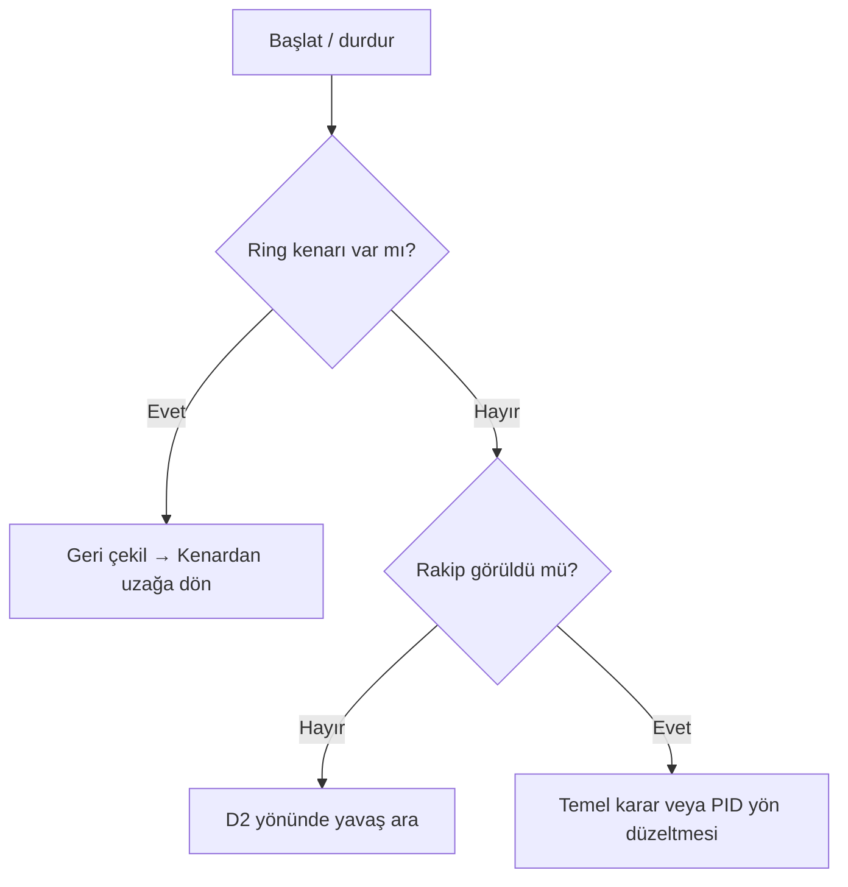

# 🤖 Robot Algoritma Atölyesi

**Hazırlayan: Emre Demiröz · Mucit Akademisi**

Kalibrasyondan başlayıp davranış kurallarına, oradan PID ile yönlendirmeye geçiyoruz. Örnekler bağımsız Arduino Nano eskizleridir; her klasörün kendi `.ino` dosyasını aç. Eski ders örnekleri ayrıca korunur.

| Durak | Ne deneyeceğiz? |
| --- | --- |
| [🔎 01 Sharp kalibrasyonu](01_Sharp_Kalibrasyon/01_Sharp_Kalibrasyon.ino) | Motorlar kapalıyken iki sensörün ham değerlerini okuyacağız. |
| [🧱 02 Duvarda dur](02_Duvarda_Dur/02_Duvarda_Dur.ino) | Yakın engelde dur; D11, D12, D13'ü yak; D3 buzzer'ı bir saniye öttür. |
| [🏁 03 Temel sumo](03_Sumo_Temel/03_Sumo_Temel.ino) | Sağ görürse sağa, sol görürse sola, ikisi görürse ileri; görmezse yavaşça ara. |
| [🎯 04 Mini / midi sumo PID](04_Mini_Midi_Sumo_PID/04_Mini_Midi_Sumo_PID.ino) | İki analog sensörün normalize farkıyla rakibe yönel. |
| [🛣️ 05 Çizgi deneyleri](05_Cizgi_Deneyleri/05_Cizgi_Deneyleri.ino) | Tek çizgi merkezi, tek çizginin kenarı ve iki sınır çizgisi arası. |

## 🔌 Güncel robot bağlantıları

| Eleman | Pin | Açıklama |
| --- | --- | --- |
| Sol motor sürücü girişleri | D5–D6 | Kullanıcının doğruladığı yön eşlemesi |
| Sağ motor sürücü girişleri | D9–D10 | PWM sınırı ilk deneylerde 180 |
| Başlat / durdur | D7 | GND'ye bağlanan buton, INPUT_PULLUP; basınca aç/kapat |
| Taktik anahtarı | D2 | INPUT_PULLUP; açıkta sağ arama, GND'de sol arama |
| LED / buzzer | D11, D12, D13 / D3 | Duvarda dur örneğinde kullanılır |
| Sharp sol / sağ | A0 / A1 | **Önerilen sinyal pinleri**, kablolamayı kontrol et |
| Sumo ön kenar sol / sağ | A2 / A3 | **Önerilen pinler**; ring sensörlerini doğrula |
| Çizgi sensör dizisi | A0–A7 | Soldan sağa sekiz analog sensör; sumoyla aynı anda değil |

Motorlar sürücüye bağlanır. Sürücü etkinleştirme/STBY bağlantısının kart üzerinde nasıl yapıldığını doğrula. Tekerlekler havadayken pozitif komutun iki tarafta da ileri döndürdüğünü kontrol et; ters taraf için motor kablosunu veya ilgili yön eşlemesini düzelt. D7 anahtarı kilitli tipse her yeni başlatma için bırakıp tekrar etkinleştir. D2 motorlu fan/emitter olarak kullanılmaz; emitter gerekiyorsa doğrulanmış ayrı pin veya sabit besleme gerekir.

## 🔎 Sharp kalibrasyonu: büyük değer her zaman yakın mı?

01 numaralı eskizde Seri Monitör'ü **115200** aç. Sol ve sağa ayrı ayrı hedef getir. Sensörünün modeline uygun mesafe aralığında uzak, orta, yakın noktaları ölç; siyah/beyaz ve eğik hedefleri karşılaştır. Çok yakındaki kör bölge doğrusal değildir; model bilinmeden cm formülü veya her mesafede monoton artış varsayma.

| Ölçülen mesafe | Sol ham değer | Sağ ham değer | Hedef / açı |
| --- | --- | --- | --- |
| — | — | — | — |

Yakınlık eşiklerini `NEAR_L`, `NEAR_R` ile; yönünü `NEAR_IS_HIGH` ile ayarla. PID için her sensörün `RAW_FAR_*`, `RAW_NEAR_*` değerini ayrı belirle. Besleme, ortak GND ve çıkış gerilimini kartına göre doğrula. Analog sensörün bağlantısız halde rastgele değer üretmesini kod tek başına güvenilir algılayamaz.

## 🧱 Duvar deneyi

02'de D7 ile başlat: robot düşük hızla ilerler, herhangi bir Sharp sensörünün yakın eşiğinde **kilitlenerek durur**. Üç LED yanar, buzzer tam bir kez bir saniye çalar. Engel kalksa da kendiliğinden ilerlemez. D7 ile durdurup tekrar başlat. Eşiği önce motorsuz ölç; fren mesafesi yüzünden gerçek duvara çarpmadan önce yeterli pay bırak.

## 🏁 Sumo: önce kurallar, sonra PID

03 ve 04'te önce kalibrasyon ve ring kenarı testini yap, sonra `SENSOR_READY=true` yap. Varsayılan false iken motorlar başlamaz. D7'den sonra 5 saniye bekler; D7 bekleme dahil her evrede durdurur. Turnuva başlangıç/durdurma düzeni ayrıca ilgili kurala göre uyarlanmalıdır.

Kenar bilgisi PID'den önceliklidir. Sol ön kenarda sağa, sağ ön kenarda sola döner. Uzun arama 15 saniye sonra durur. Bunlar **ön kenar sensörlü sınıf örnekleridir**; arka kenar algılaması yoktur, geri kaçış sırasında arka sınırı koruyamaz. Ringde gözetimsiz kullanma; arka sensörlü tasarım ayrı doğrulanmalı.

### 🎯 PID neyi kontrol ediyor?

Hata = (sağ yakınlık − sol yakınlık) / (sağ yakınlık + sol yakınlık + küçük pay). Pozitif hatada sol motor hızlanır, sağ motor yavaşlar. Bu, **rakibi ortalama PID'sidir**; enkoderli tekerlek hız PID'si değildir. Enkoder varsa hız döngüsü için kanal pinleri, darbe/devir ve dişli oranı ayrıca gerekir.

10 ms örnekleme hedefi, gerçek dt, filtreli türev, integral sınırı ve doygunlukta integral birikimini azaltma vardır. Başlangıçta Ki=0: önce düşük hızda Kp, sonra Kd ayarla. Kazançlar deneme değeridir. `MIDI_PROFILE=true` ayrı düşük hızlı deney profilini seçer; robotun kütlesini, akım sınırını ve yarışma uygunluğunu otomatik ayarlamaz. Mini ve midi sürümünü aynı kodun iki ayarıyla karşılaştır.

**Taktik deneyleri:** Sürekli sağ arama ile sol aramayı; dönerek arama ile kısa ileri hamleyi karşılaştır. İlk sürümde kör ileri hamle yoktur; ancak hedef tekrar algılandığında ileri geçilir. Hamle eklenecekse tüm süre boyunca kenar ve durdurma denetimi korunmalıdır.

## 🛣️ Üç çizgi algoritması

05 numaralı eskizde `MODE` seç:

| Mod | Pist | Algoritma |
| --- | --- | --- |
| `SINGLE_CENTER` | Açık zeminde tek koyu şerit | Koyu sensör grubunun ağırlıklı merkezini dizi ortasına getir. |
| `SINGLE_EDGE` | Bir koyu şeridin sağ kenarı | Grubun sağ kenarını hedefe getir; sol kenar için ayrıca değiştirilir. |
| `TWO_BOUNDARIES` | İki koyu çizgi arasındaki açık koridor | İki ayrı grubun iç kenarlarının orta noktasını hedefle. |

Tek çizginin “arasında ilerleme” isteğini **tek şeridi ortalama** ve **kenarını takip etme** olarak iki ayrı deney yaptık. İki çizgi modunda iki çizgi de aynı anda sensör dizisinin görüş genişliğinde olmalı. Pist fazla genişse bu donanımla orta nokta çıkarılamaz.

İlk 5 saniye robot durur: diziyi **elle** siyah ve beyaz üzerinde gezdir. Her sensörde yeterli fark oluşmazsa başlatmayı reddeder. Sonra D7 ile başlat. Çizgi kaybında hemen motorları keser; 300 ms kayıp sürerse yeniden D7 ister. Kavşak veya üç grup görünce de belirsizliği durma olarak ele alır. Siyah düşük çıkıyorsa `BLACK_HIGH=false` seç.

| Deney | Mod / hız | Tur süresi | Çıkma sayısı | Durma sayısı | Gözlem |
| --- | --- | --- | --- | --- | --- |
| 1 | — | — | — | — | — |

Aynı parkurda önce 5 düşük hızlı tur önerilir. Tek değişken değiştir: önce mod, sonra hız, sonra kazanç. Sonuçlar henüz ölçülmedi.

## ✅ Doğrulama durumu

Beş eskiz yerel AVR-G++ ile Arduino Nano / ATmega328P başlıkları kullanılarak nesne dosyasına derlendi. Bu kontrol tam firmware bağlama, kartta yükleme veya fiziksel test değildir. Sensör işaretleri, motor yönleri, fren mesafesi ve kazançlar gerçek robotta doğrulanmalıdır.

[🏠 Ders kitabına dön](../README.md) · [🏎️ Önceki çizgi robotları](../Profesyonel_Cizgi_Izleyen/README.md)
